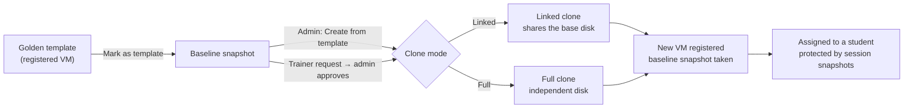

# Cloning VMs: how it works and how to illustrate it

This guide explains the template/clone feature and gives a repeatable demo you can screenshot for the
project report.

## 1. The idea

A **golden template** is one known-good VirtualBox VM (operating system, tools, and lab software already
installed). You never hand-edit clones from scratch; you copy the template:

```
Golden template (registered VM)
        │  mark as template → baseline snapshot (automatic if none exists)
        ├──────────────► Linked clone  → tiny differencing disk, instant
        └──────────────► Full clone    → complete independent copy
                              │
                              ▼
                 New VM registered in the app
                 + automatic "baseline" snapshot
                 + optional student assignment
```

Mermaid version (GitHub renders this):



## 2. Linked vs full clone

| | Linked clone | Full clone |
|---|---|---|
| VirtualBox command | `clonevm --options link --snapshot <baseline>` | `clonevm --mode all` |
| Disk used | Very small; writes go to a differencing disk | Full size of the source disk |
| Creation time | Seconds | Minutes, depending on disk size |
| Independence | Needs the template's base disk and baseline snapshot | Fully independent |
| Good for | A classroom of short-lived student VMs | Long-lived machines, or when the template may be retired |
| Danger | Deleting the template/base disk breaks every linked clone | None from the template |

The app takes a **baseline snapshot** of every new clone, so the recovery worker can restore it later.

## 3. Demo in the web UI (recommended for screenshots)

1. **Prepare a template.** Log in as admin → **Virtual Machines**. Register a VM, or pick an existing one
   and click **Template (No)** so it becomes **Template (Yes)**. If the VM has no snapshot, the app takes a
   baseline snapshot immediately.
2. **Screenshot A:** the VMs page showing the template badge and the **Create New VM from Template (Clone)**
   panel.
3. **Clone directly.** In that panel choose the template, enter a name such as `LAB-CLONE-01`, a class group,
   and **Linked clone** (or **Full clone**), then click **Clone & Create in VirtualBox**.
4. **Screenshot B:** the VMs table after the clone, showing `LAB-CLONE-01`, its class group, and its
   snapshot time.
5. **Show the request workflow.** Log in as a trainer → **Requests** → submit a request for a linked clone.
   Then log in as admin → **Requests** and approve it.
   **Screenshot C:** the pending request; **Screenshot D:** the approved/ready request.
6. **Show the snapshots page** for the new clone (it contains the automatic `baseline-…` snapshot).
   **Screenshot E:** Snapshots page.

## 4. Demo from the terminal (proof that VirtualBox really cloned it)

Run these after the UI clone:

```bash
VBoxManage list vms
VBoxManage showvminfo LAB-CLONE-01 --machinereadable | grep -E '^(name|UUID|VMState)='
VBoxManage snapshot LAB-CLONE-01 list
VBoxManage list hdds | grep -A6 -i 'LAB-CLONE-01'
```

For a **linked clone**, `VBoxManage list hdds` shows a small disk whose `Parent UUID` points at the
template's base disk. For a **full clone**, the disk has no parent and is roughly the template's disk size.

You can also create the two modes by hand for a side-by-side comparison (use throwaway names):

```bash
# Linked clone (a snapshot name from: VBoxManage snapshot "<template>" list)
VBoxManage clonevm "<template>" --name DEMO-LINKED --register \
  --options link --snapshot "<baseline-snapshot-name>"

# Full clone
VBoxManage clonevm "<template>" --name DEMO-FULL --register --mode all

# Compare disk sizes and parent UUIDs
VBoxManage list hdds | grep -E -A6 'DEMO-LINKED|DEMO-FULL'
```

## 5. What to write under each figure

- **Figure: Template management.** “A registered VM is promoted to a golden template; the system takes a
  baseline snapshot so linked clones have a parent state.”
- **Figure: Clone provisioning.** “The admin clones the template in either linked or full mode. The new VM
  is registered automatically and receives a baseline snapshot.”
- **Figure: Trainer request workflow.** “Trainers request VMs; an administrator approves, and the system
  performs the clone without manual VirtualBox steps.”
- **Figure: Linked-clone storage.** “VirtualBox reports a differencing disk with the template disk as its
  parent, demonstrating space-efficient provisioning.”
- **Figure: Session lifecycle.** “Starting a class session takes a pre-session snapshot per VM; pressing
  Start again is idempotent, and End session takes a post-session snapshot and powers the group off.”

## 6. Practical cautions

- A linked clone cannot be made from a template with no snapshot. The app takes one when you mark the
  template, and refuses with a clear message if a snapshot is still missing.
- Keep the template registered (and its base disk intact) for as long as linked clones exist.
- For a clean classroom image, shut the template down (or mark it as a template and use a baseline
  snapshot taken from a clean state) before cloning. Cloning a machine that is in use captures whatever
  state is on its disks at that moment.
- The demo writes real VMs into VirtualBox. Use throwaway names and delete them afterwards with
  `VBoxManage unregistervm DEMO-LINKED --delete`.
